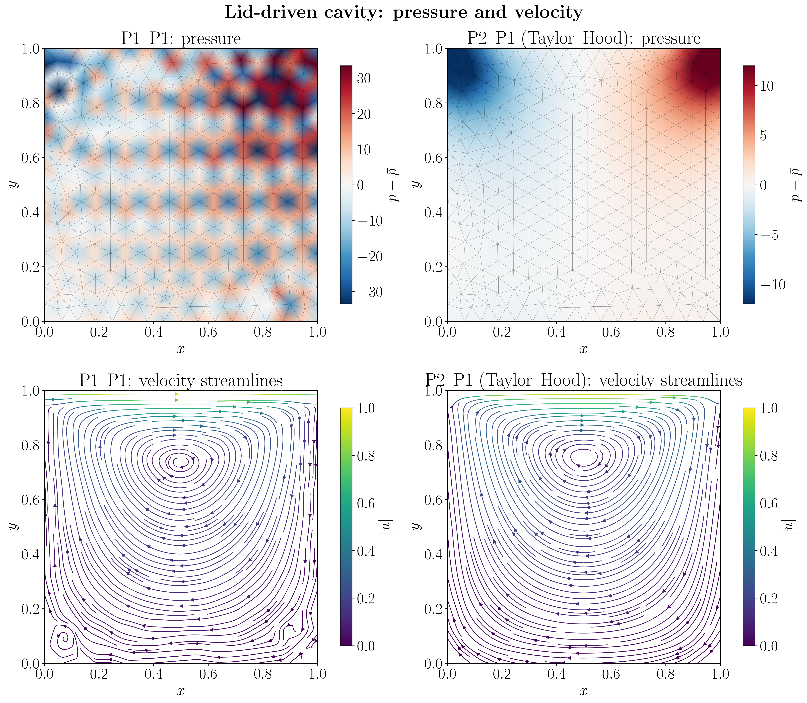
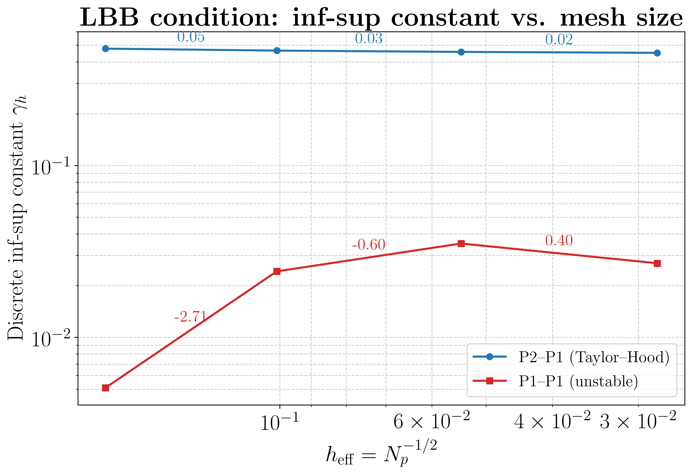
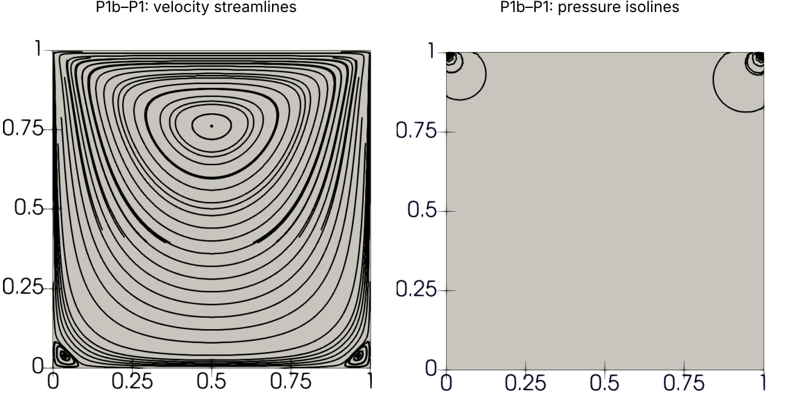
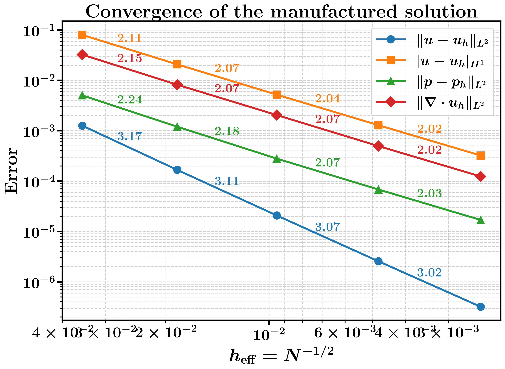
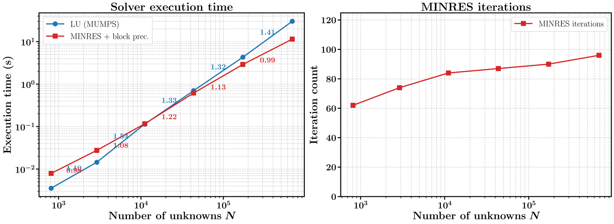

# Stokes flow in a lid-driven cavity

Finite element simulation of two-dimensional Stokes flow in a lid-driven cavity, built with [FEniCSx](https://fenicsproject.org) and [PETSc](https://petsc.org) as a seminar project at the University of Vienna. The project covers three questions:

1. **Element stability:** which velocity–pressure element pairs give a stable solution (P2–P1, P1–P1, P1b–P1)?
2. **Verification:** does the code converge at the rates the theory predicts? (method of manufactured solutions)
3. **Solvers:** how does a direct solver scale compared with a preconditioned iterative solver?

## Results at a glance

| Question | Result |
| --- | --- |
| Element stability | P2–P1 (Taylor–Hood) and P1b–P1 (MINI) give smooth pressures. P1–P1 produces strong spurious pressure oscillations, and its discrete inf-sup constant is 13 to 95 times smaller. |
| Verification | With P2–P1, all errors converge at the theoretical rates: order 3 for the velocity in L², order 2 for the velocity in H¹ and for the pressure in L². |
| Solvers | At 685,000 unknowns, MINRES with a block-diagonal field-split preconditioner is 2.6 times faster than a sparse LU factorisation (11.5 s vs 30.2 s), and its iteration count stays almost constant. |

**Slides:** the theory is presented in the [Applied Analysis Seminar slides](presentations/applied_math_presentation/presentation.pdf) and the implementation and experiments in the [Computational Analysis Seminar slides](presentations/comp_math_presentation/presentation.pdf).

## The problem

A viscous fluid fills the unit square $\Omega = (0,1)^2$. The top wall (the lid) slides to the right with unit speed, and the other three walls are at rest. At very low Reynolds number, the Navier–Stokes equations reduce to the Stokes equations:

$$-\Delta \mathbf{u} + \nabla p = \mathbf{0}, \qquad \nabla \cdot \mathbf{u} = 0 \qquad \text{in } \Omega,$$

$$\mathbf{u} = (1, 0)^T \text{ on the lid}, \qquad \mathbf{u} = \mathbf{0} \text{ on the other walls}.$$

In weak form: find $\mathbf{u} \in V$ and $p \in Q$ with

$$\int_\Omega \nabla\mathbf{u} : \nabla\mathbf{v} \, dx - \int_\Omega p \, \nabla\cdot\mathbf{v} \, dx = 0, \qquad \int_\Omega q \, \nabla\cdot\mathbf{u} \, dx = 0 \qquad \text{for all } \mathbf{v} \in V, \ q \in Q,$$

where $V$ is the space of $H^1$ velocity fields that vanish on the boundary and $Q$ the space of $L^2$ pressures with zero mean. A Galerkin discretisation turns this into a symmetric, indefinite saddle-point system

$$\begin{pmatrix} A & B^T \\ B & 0 \end{pmatrix} \begin{pmatrix} \mathbf{U} \\ \mathbf{P} \end{pmatrix} = \begin{pmatrix} \mathbf{f} \\ \mathbf{0} \end{pmatrix}.$$

The lid velocity jumps at the two top corners, so the pressure is singular there. This shows up as the two pressure peaks in the plots.

## Implementation

- **Mesh** (`src/mesh_setup.py`): unstructured triangular mesh of the unit square, generated with Gmsh (Frontal–Delaunay) for a given target edge length $h$.
- **Weak form and boundary conditions** (`src/problem_builder.py`): the four blocks of the saddle-point system written in UFL, with the lid and no-slip conditions as Dirichlet conditions on the velocity.
- **Pressure constant:** the pressure is only determined up to a constant. The direct solver handles this with MUMPS null-pivot detection; the iterative solver gets the constant pressure mode as an explicit null space.
- **Output** (`run_simulation.py`): velocity and pressure are written as ADIOS2 `.bp` files and visualised in ParaView.

## 1. Element stability

A velocity–pressure pair is stable if it satisfies the discrete inf-sup (LBB) condition

$$\inf_{q_h \in Q_h} \sup_{\mathbf{v}_h \in V_h} \frac{\int_\Omega q_h \, \nabla\cdot\mathbf{v}_h \, dx}{|\mathbf{v}_h|_{H^1} \, \|q_h\|_{L^2}} \;\geq\; \beta > 0,$$

with $\beta$ independent of the mesh size. In `LBB_test.ipynb`, the discrete constant $\gamma_h$ is computed from the smallest non-zero eigenvalue of the generalised eigenproblem $B A^{-1} B^T \mathbf{p} = \lambda M_p \mathbf{p}$, where $M_p$ is the pressure mass matrix.

| Pressure unknowns | $\gamma_h$, P2–P1 | $\gamma_h$, P1–P1 |
| ---: | ---: | ---: |
| 31 | 0.478 | 0.005 |
| 98 | 0.466 | 0.024 |
| 338 | 0.458 | 0.035 |
| 1,262 | 0.452 | 0.027 |

- **P2–P1 (Taylor–Hood)** keeps $\gamma_h \approx 0.45$ on every mesh: stable.
- **P1–P1** has a much smaller and erratic $\gamma_h$, so the pressure is not controlled. The result is the oscillating pressure in the plot at the top of this page, with visible artefacts in the velocity field too.
- **P1b–P1 (MINI element)** enriches the P1 velocity with a cubic bubble function on each triangle (Arnold, Brezzi and Fortin, 1984). This restores stability at a lower cost than P2–P1, and the pressure becomes smooth again:

## 2. Verification with manufactured solutions

To check the implementation, the code solves a problem with a known exact solution (`code_validation.ipynb`). The velocity is derived from the stream function $\psi = \sin(\pi x_1)\sin(\pi x_2)$, so it is exactly divergence-free:

$$\mathbf{u} = \pi \begin{pmatrix} \sin(\pi x_1)\cos(\pi x_2) \\ -\cos(\pi x_1)\sin(\pi x_2) \end{pmatrix}, \qquad p = \cos(\pi x_1)\cos(\pi x_2),$$

and the matching body force $\mathbf{f} = -\Delta\mathbf{u} + \nabla p$ is added to the right-hand side. The errors are then measured on meshes from $h = 1/8$ to $h = 1/128$.

| Error | Expected rate (P2–P1) | Observed rate (finest meshes) |
| --- | :---: | :---: |
| $\lVert\mathbf{u} - \mathbf{u}_h\rVert_{L^2}$ | 3 | 3.02 |
| $\lvert\mathbf{u} - \mathbf{u}_h\rvert_{H^1}$ | 2 | 2.02 |
| $\lVert p - p_h\rVert_{L^2}$ | 2 | 2.03 |
| $\lVert\nabla\cdot\mathbf{u}_h\rVert_{L^2}$ | 2 | 2.02 |

All errors converge at the rates predicted by the a priori error estimates (inf-sup stability, interpolation estimates and the Aubin–Nitsche duality argument).

## 3. Direct vs iterative solver

`execution_time.ipynb` compares two ways of solving the saddle-point system with P2–P1 elements, on meshes from $h = 1/8$ to $h = 1/256$:

- **Direct:** sparse LU factorisation with MUMPS. Expected cost: $O(N^{3/2})$ in 2D.
- **Iterative:** MINRES, which suits symmetric indefinite systems, with the block-diagonal preconditioner

$$\mathcal{P} = \begin{pmatrix} \hat{A} & 0 \\ 0 & \hat{M}_p \end{pmatrix},$$

where $\hat{A}$ is one algebraic multigrid V-cycle (PETSc `gamg`) on the velocity block and $\hat{M}_p$ is the diagonal of the pressure mass matrix (`jacobi`), set up with PETSc's additive field-split. Expected cost: $O(N)$.

| Unknowns $N$ | LU time (s) | MINRES time (s) | MINRES iterations |
| ---: | ---: | ---: | ---: |
| 812 | 0.004 | 0.008 | 62 |
| 2,908 | 0.014 | 0.028 | 74 |
| 11,096 | 0.114 | 0.116 | 84 |
| 43,483 | 0.700 | 0.615 | 87 |
| 172,130 | 4.30 | 2.90 | 90 |
| 685,231 | 30.2 | 11.5 | 96 |

- LU scales with an exponent of about 1.35, close to the expected 1.5. Preconditioned MINRES scales with about 1.1, close to linear.
- The two solvers break even at about 10,000 unknowns. Beyond that, MINRES pulls ahead: 2.6 times faster at the finest mesh.
- The MINRES iteration count grows only from 62 to 96 while the problem grows about 840-fold, so the preconditioner is close to mesh-independent.
- Without a preconditioner, MINRES needed 279 to 3,686 iterations on the same meshes, and 114 s on the finest one.

Times are from single serial runs, so the absolute values depend on the hardware. The scaling is what matters.

## References

- A. Quarteroni, *Numerical Models for Differential Problems*, Springer, [edition]. Theory of the Stokes problem, the inf-sup condition and finite element error estimates.
- Lecture notes, *Numerics of Partial Differential Equations*, University of Vienna.
- D. N. Arnold, F. Brezzi and M. Fortin, A stable finite element for the Stokes equations, *Calcolo* 21 (1984), 337–344. The MINI element.
- O. Botella and R. Peyret, Benchmark spectral results on the lid-driven cavity flow, *Computers & Fluids* 27 (1998), 421–433.
- [FEniCSx documentation](https://docs.fenicsproject.org), [PETSc documentation](https://petsc.org/release/) and [Gmsh documentation](https://gmsh.info/doc/texinfo/gmsh.html), for the implementation.
- [DefElement](https://defelement.org), for the finite element definitions.

## A note on tools

I set up the simulation and ran the experiments myself, working from the FEniCSx and PETSc documentation, Quarteroni's book and my lecture notes. I used AI assistants for background research, for checking my reasoning and for some simple scripts, and Claude (Anthropic's AI assistant) to help write this README.
